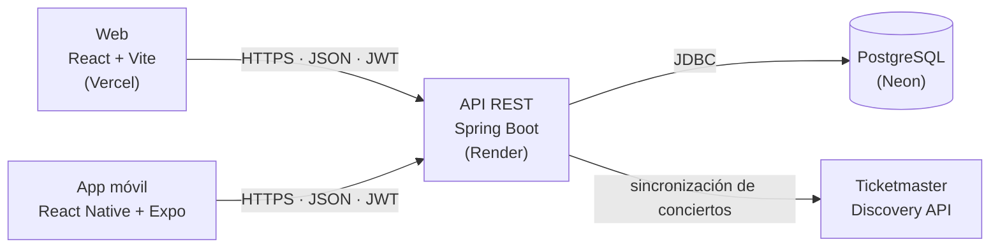

# Concert Tracker

Plataforma para descubrir conciertos en Lima por artista, ciudad o fecha, registrar la asistencia personal, seguir artistas y compartir reseñas. Este repositorio tiene tres partes:

| Parte | Carpeta | Tecnología | Documentación |
|---|---|---|---|
| **API REST** | raíz | Spring Boot 4, Spring Security (JWT), PostgreSQL | este archivo |
| **Web** | [`web/`](web/) | React 19, Vite, Tailwind CSS | [web/README.md](web/README.md) |
| **App móvil** | [`mobile/`](mobile/) | React Native con Expo | [mobile/README.md](mobile/README.md) |

## Participación del equipo

El porcentaje indica el cumplimiento de las responsabilidades de cada integrante (100 % = cumplimiento completo).

| Integrante | Principales aportes | Participación |
|---|---|---|
| **Tamara Iberico Gomez** | **Web completa** (React + Vite + Tailwind): cliente axios con interceptores y refresh de token, rutas privadas, listados con búsqueda, filtros y paginación, onboarding, dashboard, perfil, página de artista, manejo de errores, `AbortController`, reintentos y UI/UX. **Backend:** paginación, filtro de artistas por género, integración con Ticketmaster, zonas y precios, favoritos y datos de demostración. **Deploy de la web** en Vercel, README de la web y arquitectura general. | 100 % |
| **Maria Fernanda Carbajal** | **App móvil completa** (React Native + Expo): autenticación con `expo-secure-store`, detalle de concierto, asistencia, reseñas, clima, filtro "cerca de mí", escaneo de QR e historial. **Backend:** `users/me`, seguimiento de artistas y reseñas por concierto con su feed. **Deploy del backend** en Render (Docker) y publicación de la app con EAS Update. | 100 % |

## URLs públicas

| | URL |
|---|---|
| Web (Vercel, HTTPS) | https://concert-tracker-one.vercel.app |
| API (Render, HTTPS) | https://concert-tracker-6sbr.onrender.com |
| Colección de Postman | [`postman_collection.json`](postman_collection.json) |

> El backend corre en el plan gratuito de Render y se duerme tras un rato sin uso: la primera petición puede tardar hasta ~2 minutos. Conviene abrir la URL de la API unos minutos antes de una demo.

## Arquitectura



La web y la app móvil consumen la misma API. Los conciertos reales los importa el backend desde Ticketmaster; los precios y zonas se completan a mano en `ticketmaster-zones.json`, porque Ticketmaster no los entrega.

## Cómo correr el backend en local

Necesitas **Java 21** y **Docker**.

```bash
# 1. Base de datos
docker run -d --name concert-db -p 5432:5432 \
  -e POSTGRES_PASSWORD=postgres -e POSTGRES_DB=concert_tracker postgres:17

# 2. API en http://localhost:8080 (con datos de demostración)
DEMO_DATA_ENABLED=true ./mvnw spring-boot:run
```

Hibernate crea las tablas (`ddl-auto=update`). Con `DEMO_DATA_ENABLED=true` se cargan conciertos, artistas y el usuario `demo@concerttracker.com` (contraseña `Demo12345`, configurable con `DEMO_USER_PASSWORD`). La raíz `http://localhost:8080/` responde 401: es normal, la API no tiene página.

Para la web, sigue [web/README.md](web/README.md); para la app móvil, [mobile/README.md](mobile/README.md).

## Funcionalidades Implementadas

### Descubrimiento (Artist, Concert, Venue)

Los `GET` son públicos. Crear, actualizar y eliminar requiere un token de un usuario `ADMIN`.

- **Venues:** CRUD en `/api/v1/venues` y `GET /api/v1/venues/{id}/concerts` (conciertos del venue, ordenados por fecha).
- **Artists:** CRUD en `/api/v1/artists` (nombre único) y `GET /api/v1/artists/{id}/concerts`.
- **Concerts:** CRUD en `/api/v1/concerts`. El detalle incluye el artista y el venue embebidos. Eliminar un venue o un artista con conciertos responde 409.

**Búsqueda** con `GET /api/v1/concerts/search`, usando Specifications. Los filtros son opcionales y combinables: `artist` (texto parcial), `country`, `city`, `date` (`yyyy-MM-dd`) y `upcoming` (`true` próximos, `false` pasados).

Ejemplo: `/api/v1/concerts/search?artist=bad&city=Lima&upcoming=true`

**Paginación y orden:** los listados de conciertos, artistas y reseñas usan `page` (desde 0), `size` y `sort` (por ejemplo `?page=0&size=25&sort=date,asc`) y responden `{content, totalElements, totalPages, ...}`. Por defecto `size=10`; conciertos se ordenan por `date` y artistas por `name`.

**Filtro de artistas por género:** `GET /api/v1/artists?genreId=3` devuelve solo los artistas de ese género, también paginado.

**Zonas y precios:** el detalle de un concierto incluye sus `zones` (nombre y precio por zona), `ticketUrl` (enlace oficial de compra) y `ticketPrice` (precio de referencia). Un concierto sin precio publicado se muestra como "Precio por confirmar".

### Interacción del usuario (Attendance, Review, Follow)

Todos requieren token. El usuario se obtiene del JWT (`SecurityUtils.getCurrentUserId()`), así que nadie puede actuar en nombre de otro.

| Método | Ruta | Descripción |
|---|---|---|
| POST | `/api/v1/user-interactions/attendance` | Marca o cambia la asistencia (`VOY_A_IR` o `YA_FUI`) |
| GET | `/api/v1/user-interactions/attendance/history` | Historial, con filtro opcional `?status=` |
| POST | `/api/v1/user-interactions/reviews` | Crea una reseña (`rating` de 1 a 5) |
| POST | `/api/v1/user-interactions/follow` | Sigue a un artista |
| DELETE | `/api/v1/user-interactions/follow/{artistId}` | Deja de seguir a un artista |
| PUT / DELETE | `/api/v1/user-interactions/favorites/{concertId}` | Agrega o quita un concierto de favoritos |
| GET | `/api/v1/user-interactions/my-concerts` | Conciertos del usuario según su asistencia |
| GET | `/api/v1/user-interactions/concerts/{concertId}` | Estado del usuario en un concierto (asistencia, favorito, reseña) |
| GET / PUT | `/api/v1/users/me` | Consulta o actualiza el perfil propio |
| GET | `/api/v1/users/me/follows` | Artistas que sigue |
| GET | `/api/v1/users/me/favorite-concerts` | Conciertos favoritos (paginado) |
| GET | `/api/v1/users/me/reviews` | Sus reseñas (paginado) |

**Reseñas públicas:** `GET /api/v1/concerts/{id}/reviews` (reseñas de un concierto, paginado) y `GET /api/v1/reviews/recent` (feed de reseñas recientes) no requieren token.

**Reglas de negocio** (en el service):

- Solo se puede reseñar si la asistencia es `YA_FUI`; si no, responde 409.
- No se puede marcar `YA_FUI` en un concierto futuro.
- Solo se permite una reseña por concierto y un follow por artista; los duplicados responden 409.
- Si el concierto o el artista no existe, responde 404. Los datos inválidos responden 400 (Bean Validation).

### Manejo de errores

`GlobalExceptionHandler` devuelve siempre `{timestamp, status, error, message, path}`. Los códigos son: 400 (validación), 401 (sin token o token inválido), 403 (rol insuficiente), 404 (no existe), 409 (duplicado o conflicto) y 500 (error interno).

### Integración con Ticketmaster

El backend importa conciertos de música de Perú desde la **Ticketmaster Discovery API**. Como esa API no entrega precios, estos se completan con el archivo `src/main/resources/ticketmaster-zones.json` (zonas, precios y enlace de compra por concierto), que la sincronización aplica sobre los conciertos importados. Los conciertos pasados reales salen de `past-concerts.json`.

- **Manual:** `POST /api/v1/admin/sync/ticketmaster` (solo `ADMIN`). Es idempotente: se puede ejecutar varias veces.
- **Automática:** apagada por defecto. Con `TICKETMASTER_SYNC_ENABLED=true` corre al arrancar y todos los días a las 3:00 a. m.
- Requiere `TICKETMASTER_API_KEY`.

### Datos de demostración

Con `DEMO_DATA_ENABLED=true`, `DemoDataLoader` carga artistas, recintos, conciertos, un usuario demo y usuarios de ejemplo con asistencias y reseñas. Está desactivado por defecto y no duplica datos si se vuelve a arrancar.

## Seguridad Implementada

La autenticación usa JWT y no guarda sesiones en el servidor. Las rutas protegidas llevan `Authorization: Bearer <token>`.

- `POST /api/v1/auth/register`: crea la cuenta y devuelve los tokens.
- `POST /api/v1/auth/login`: valida las credenciales y devuelve los tokens.
- `POST /api/v1/auth/refresh`: entrega un access token nuevo.

Las contraseñas se guardan con **BCrypt**. El **access token** dura 15 minutos y el **refresh token** 7 días; cada uno lleva un claim `type` para que no se puedan intercambiar. `JwtAuthenticationFilter` valida el token en cada request.

**Roles:** todo usuario empieza como `USER`, y el rol `ADMIN` se asigna manualmente. Las escrituras de catálogo usan `@PreAuthorize("hasRole('ADMIN')")`. Sin token la API responde 401; con un rol insuficiente, 403.

**Genres:** CRUD en `/api/v1/genres`, con lectura pública y escritura solo para ADMIN.

## Eventos y Asincronía

Las tareas secundarias, como enviar un correo, no hacen esperar al usuario. El service publica un evento con `ApplicationEventPublisher` y `EmailNotificationListener` lo procesa en otro hilo.

| Evento | Se publica al | Acción del listener |
|---|---|---|
| `AttendanceCreatedEvent` | Marcar o cambiar la asistencia | Confirmación de asistencia |
| `ReviewCreatedEvent` | Crear una reseña | Confirmación de reseña |
| `ConcertCreatedEvent` | Crear un concierto | Avisa a los seguidores del artista que viven en la misma ciudad y país del venue |

- Los eventos son `record` inmutables, así que el service no depende de quién los escucha.
- `@EnableAsync` activa la ejecución asíncrona, y cada listener usa `@EventListener` + `@Async`. El endpoint responde de inmediato aunque el envío tarde o falle.
- **Limitación:** el correo se simula con un log. Para enviarlo de verdad hay que agregar `spring-boot-starter-mail` y un servidor SMTP.

## Modelo de Entidades

| Entidad | Campos principales |
|---|---|
| **User** | `name`, `email` (único), `password` (BCrypt), `role`, `country`, `city`, `bio`, `createdAt` |
| **Genre** | `name` (único) |
| **Venue** | `name`, `city`, `country`, `address`, `capacity` |
| **Artist** | `name` (único), `country`, `description`, `imageUrl` |
| **Concert** | `title`, `date`, `ticketPrice`, `imageUrl`, `ticketUrl`, `externalId` (único, identifica el origen: Ticketmaster o histórico), `artist`, `venue` |
| **ConcertZone** | `concert`, `name`, `price` (única por concierto y nombre) |
| **FavoriteConcert** | `userId`, `concertId`, `createdAt` |
| **Attendance** | `userId`, `concertId`, `status` (`VOY_A_IR`/`YA_FUI`), fechas |
| **Review** | `userId`, `concertId`, `rating` (1-5), `comment` |
| **Follow** | `userId`, `artistId`, `createdAt` |

**Relaciones:**

- Venue → Concert y Artist → Concert, de uno a muchos.
- Concert → ConcertZone, de uno a muchos.
- Genre ↔ Artist, de muchos a muchos (tabla `artist_genres`).
- Attendance, Review y FavoriteConcert son intermedias entre User y Concert, y Follow entre User y Artist, con restricción única por par.

## Deployment

| Parte | Plataforma | Cómo |
|---|---|---|
| API | **Render** (plan gratuito) | Imagen Docker construida desde el [`Dockerfile`](Dockerfile) de la raíz |
| Base de datos | **Neon** (PostgreSQL) | Hibernate crea las tablas al arrancar |
| Web | **Vercel** | Root Directory `web`, ver [web/README.md](web/README.md) |

```
Web (Vercel) ──HTTPS──►  API Spring Boot (Render)  ──JDBC──►  PostgreSQL (Neon)
App móvil   ──HTTPS──►        │
                              └──► Ticketmaster Discovery API
```

Para publicar cambios de la API se redespliega el servicio en Render desde `main`. El `Dockerfile` compila con Maven y ejecuta el `.jar` en una imagen liviana; limita el heap porque la instancia gratuita tiene 512 MB.

**Variables de entorno de la API** (en el panel de Render, nunca en el repositorio):

| Variable | Uso |
|---|---|
| `DB_URL` | URL JDBC de la base de datos (`jdbc:postgresql://<host>/<base>`) |
| `DB_USERNAME` / `DB_PASSWORD` | Credenciales de la base de datos |
| `JWT_SECRET` | Clave de firma de los tokens, de 32 caracteres o más |
| `CORS_ALLOWED_ORIGINS` | Orígenes permitidos, separados por coma. Debe incluir la URL de la web en Vercel; sin ella el navegador bloquea las peticiones |
| `TICKETMASTER_API_KEY` | Clave de la Discovery API de Ticketmaster |
| `TICKETMASTER_SYNC_ENABLED` | `true` para sincronizar al arrancar y a diario (opcional) |
| `DEMO_DATA_ENABLED` | `true` para cargar los datos de demostración (opcional) |
| `PORT` | Lo define Render; 8080 por defecto en local |

**Consideraciones:** al dormirse la instancia gratuita, la primera petición tarda; la web y la app móvil usan un timeout largo y avisan al usuario mientras despierta. Un `GET` a la API sin token en `/` responde 401, es lo esperado.
