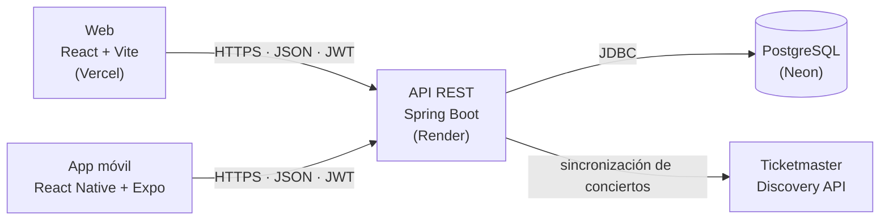

# Concert Tracker — Web

Cliente web de **Concert Tracker**, una plataforma para descubrir conciertos en Lima, marcar a cuáles vas a ir o ya fuiste, seguir artistas y dejar reseñas. Consume la API REST del backend (Spring Boot + JWT + PostgreSQL).

| | URL |
|---|---|
| Web (Vercel, HTTPS) | https://concert-tracker-one.vercel.app |
| API (Render, HTTPS) | https://concert-tracker-6sbr.onrender.com |

> **Aviso:** el backend corre en el plan gratuito de Render y se duerme tras un rato sin uso. La primera petición puede tardar hasta ~2 minutos; la web muestra un aviso mientras despierta. Conviene abrir la URL de la API unos minutos antes de usar la web.

## Stack

- **React 19** + **Vite 8**
- **Tailwind CSS 4** (diseño responsive) e iconos con `lucide-react`
- **React Router 7** (rutas con `:id`, query params, rutas privadas y lazy loading)
- **React Hook Form** (formularios y validaciones)
- **axios** (cliente HTTP centralizado) y **react-hot-toast** (avisos)

## Pantallas

| Ruta | Pantalla | Acceso |
|---|---|---|
| `/` | Portada (sin sesión) o dashboard personal (con sesión) | Público |
| `/conciertos` | Listado con búsqueda, filtros, orden y paginación | Público |
| `/conciertos/:id` | Detalle: zonas y precios, reseñas, asistencia | Público (acciones con sesión) |
| `/artistas` | Artistas con filtro por género y paginación | Público |
| `/login`, `/register` | Inicio de sesión y registro | Público |
| `/onboarding` | Elegir géneros y seguir artistas | Con sesión |
| `/mis-conciertos` | Historial de asistencias ("Voy a ir" y "Ya fui") | Con sesión |
| `/perfil` | Datos del usuario, artistas seguidos y reseñas | Con sesión |
| `*` | 404 | Público |

## Cómo correrla en local

Necesitas **Node.js 20+**, **Java 21** y **Docker**. Hay que levantar primero el backend, porque la web no funciona sin él.

### 1. Base de datos

```bash
docker run -d --name concert-db -p 5432:5432 \
  -e POSTGRES_PASSWORD=postgres -e POSTGRES_DB=concert_tracker postgres:17
```

### 2. Backend (desde la raíz del repositorio)

```bash
DEMO_DATA_ENABLED=true ./mvnw spring-boot:run
```

Queda en `http://localhost:8080`. Hibernate crea las tablas y, con `DEMO_DATA_ENABLED=true`, carga conciertos, artistas y un usuario de ejemplo. Abrir `http://localhost:8080` en el navegador responde 401: es normal, es la API y no tiene página.

### 3. Web (desde `web/`)

```bash
npm install
npm run dev
```

Abre **http://localhost:5173**.

### Usuario demo

Con los datos demo cargados puedes entrar sin registrarte:

- Correo: `demo@concerttracker.com`
- Contraseña: `Demo12345` (la define `DEMO_USER_PASSWORD`; ese es el valor por defecto)

## Comandos

```bash
npm run dev        # servidor de desarrollo (http://localhost:5173)
npm run build      # build de producción en dist/
npm run preview    # sirve el build localmente
npm run lint       # ESLint
```

## Variables de entorno

| Variable | Descripción | Local | Producción |
|---|---|---|---|
| `VITE_API_URL` | URL base del backend, sin `/api/v1` y sin barra final | `http://localhost:8080` | `https://concert-tracker-6sbr.onrender.com` |

En local la toma `.env.development` (ya incluido; solo tiene la URL local). `.env.example` documenta ambos valores. En producción se configura en el panel del hosting, nunca en un archivo. Nunca pongas secretos aquí: todo lo que empieza con `VITE_` queda visible en el navegador.

## Arquitectura



La web y la app móvil usan la misma API. Los conciertos reales los importa el backend desde Ticketmaster; los precios y zonas los completa el propio backend a mano, porque Ticketmaster no los entrega. CORS en el backend (`CORS_ALLOWED_ORIGINS`) debe incluir la URL de la web.

### Estructura de carpetas

```
src/
├── components/   componentes reutilizables (tarjetas, formularios, paginación, layout…)
├── pages/        pantallas (una por ruta)
├── hooks/        hooks personalizados
├── services/     cliente axios y llamadas a la API
├── contexts/     contexto de autenticación
├── routes/       definición central de rutas
└── utils/        formato, errores de la API, onboarding
```

## Decisiones técnicas

- **Cliente axios único** (`services/api.js`) con `baseURL` desde `VITE_API_URL`, cabecera `Authorization` automática e interceptores de respuesta.
- **Sesión con JWT:** el *access token* vive solo **en memoria** (`services/tokenStore.js`), así un script ajeno no lo lee del almacenamiento. El *refresh token* va en `sessionStorage` para sobrevivir a una recarga de la pestaña.
- **Refresh automático:** ante un 401 el interceptor pide un access token nuevo y repite la petición una sola vez, aunque varias fallen a la vez. Si el refresh también falla, cierra la sesión y avisa con un mensaje.
- **Errores diferenciados:** mensajes distintos para 400, 401, 403, 404, 409 y 500, y para fallos de red; los de red y de servidor salen además como aviso (toast).
- **Reintentos y espera:** las peticiones hacen hasta 2 reintentos ante errores de red o 502/503/504. El timeout es de 150 s por el arranque en frío del backend, y a los 8 s aparece el aviso de que el servidor está despertando.
- **`useFetch`:** carga de datos con estados `loading`/`error`, `retry` y **`AbortController`**, para cancelar la petición al desmontar o cambiar de parámetros y evitar respuestas viejas.
- **Anti doble envío:** `useSingleFlight` ignora un segundo envío mientras el primero sigue en curso; los botones se deshabilitan durante el envío.
- **`ErrorBoundary`** alrededor de las rutas: un error de renderizado muestra una pantalla de recuperación en lugar de dejar la página en blanco.
- **Rutas:** definidas en un solo archivo, con `PrivateRoute` para las pantallas con sesión, **lazy loading** + `Suspense` por página y 404.
- **Paginación en la URL:** `?page=`, `?size=` (10, 25, 50 o 100) y los filtros viven en la query string, así se pueden compartir, recargar y usar el botón atrás. Se muestra "Mostrando X–Y de Z".
- **Búsqueda con debounce** (`useDebounce`) para no llamar a la API en cada tecla.
- **Formularios** con React Hook Form y validaciones en cliente alineadas con las del backend.
- **Accesibilidad básica:** enlace "saltar al contenido", etiquetas en los campos, roles `alert` en los errores, foco visible y respeto a `prefers-reduced-motion`.

## Deploy (Vercel)

1. Importar el repositorio de GitHub en Vercel.
2. **Root Directory:** `web`. Vite se detecta solo (build `npm run build`, salida `dist`).
3. Variable de entorno: `VITE_API_URL=https://concert-tracker-6sbr.onrender.com`.
4. `vercel.json` redirige todas las rutas a `index.html`, para que recargar en `/conciertos/12` no dé 404.
5. Agregar la URL de Vercel a `CORS_ALLOWED_ORIGINS` en Render y reiniciar el backend; si no, el navegador bloquea las peticiones por CORS.

## Capturas

<!-- Pendiente: guardar las imágenes en web/docs/ y enlazarlas aquí, por ejemplo:


-->
